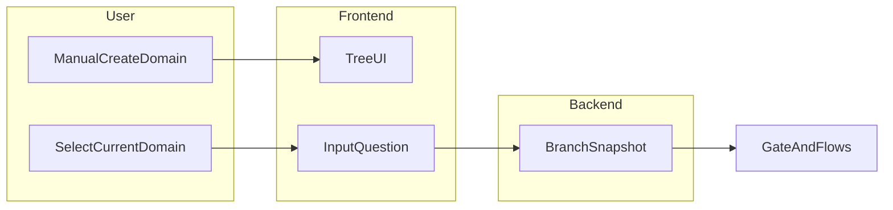
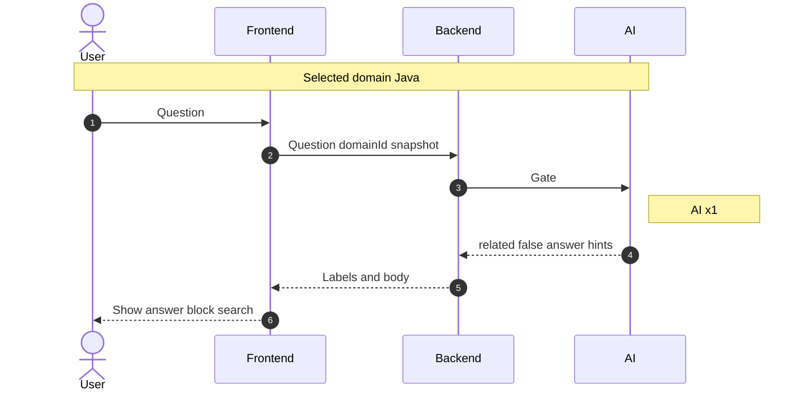
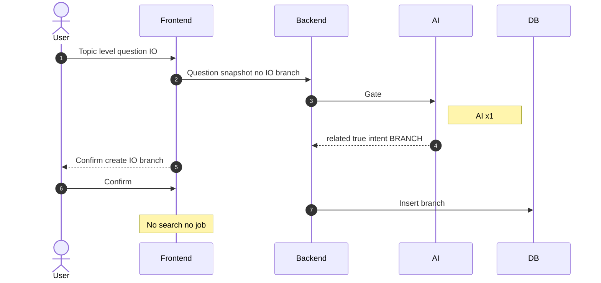
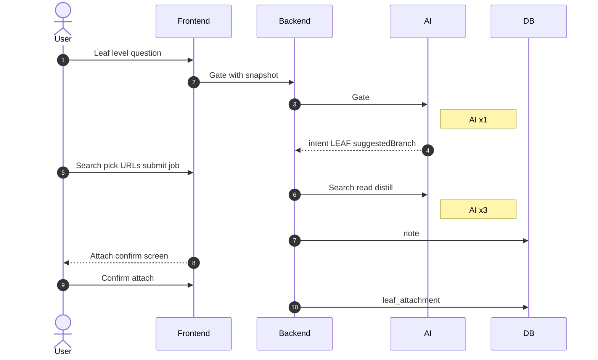
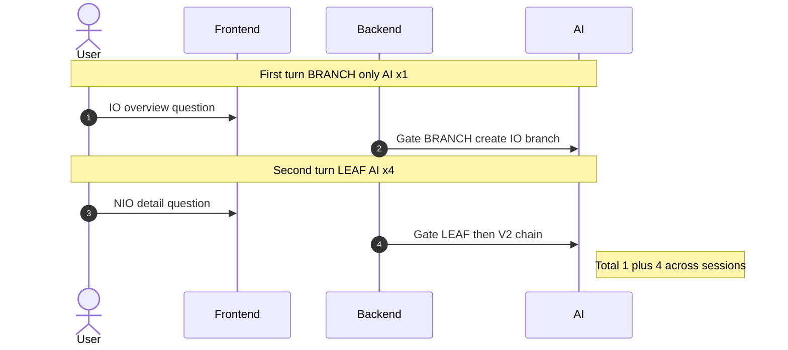
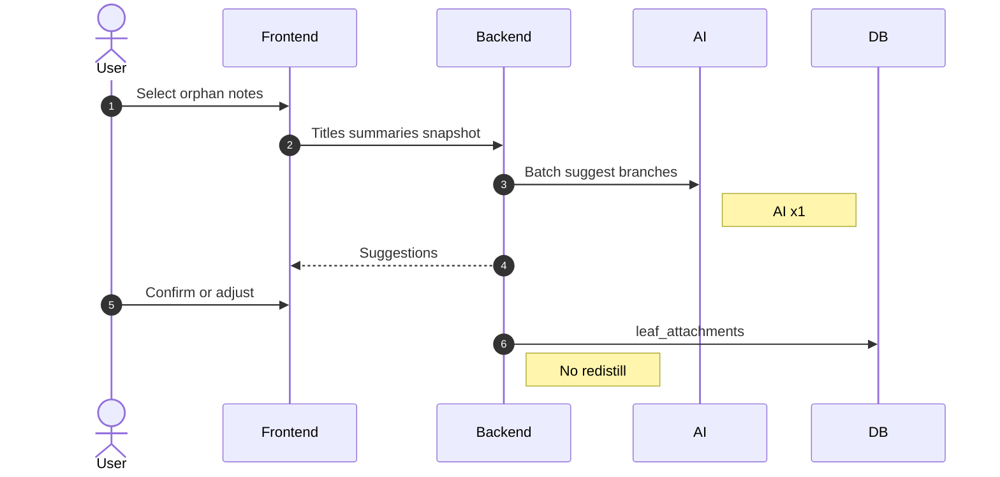
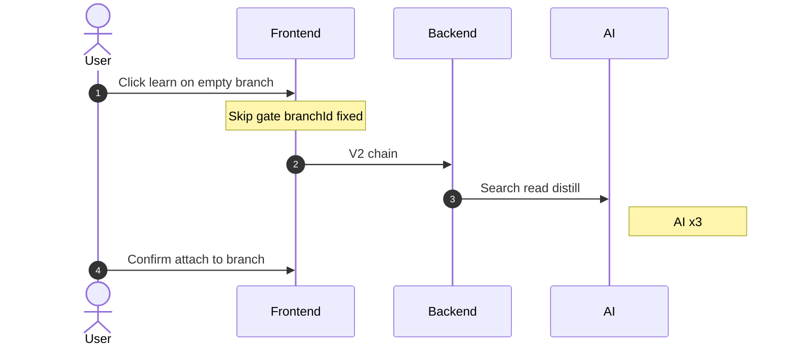
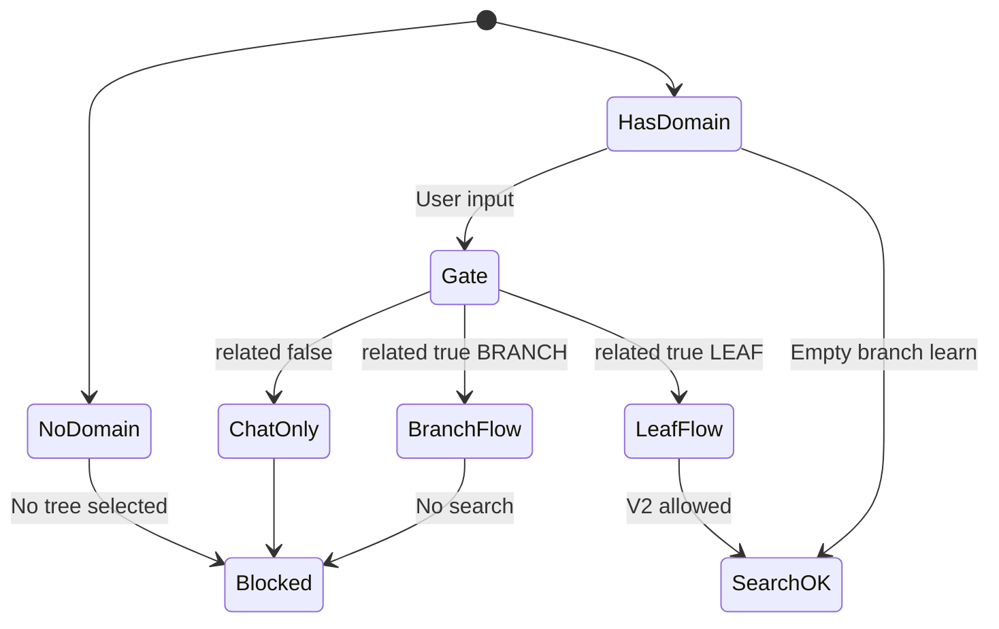

# 05 V3：领域知识树 — 产品需求报告

> **状态**：需求定稿（产品 PRD）  
> **读者**：产品 / 后端 / 前端  
> **前置**：V1 精读工作台稳定；V2 真实搜索 + 合蒸 + `knowledge_reading_job`（见 [04-v2-search-batch.md](./04-v2-search-batch.md)）  
> **替代说明**：本文 **完全替代** 旧版「Agent 学习路线 / `learning_path` 按章搜文」叙事；`learning_path` 表 **不在 V3 一期范围**。后端接口与 DDL 另文撰写（建议 `07-v3-backend.md`）。

---

## 0. 变更摘要

| 旧 05（已废弃） | 新 V3（本文） |
| --- | --- |
| 主题 → AI 生成大纲落库 → 按章搜文 | **手动领域树** + **枝/叶** + **相关门闩** |
| `learning_path` / `learning_path_item` | **domain / branch / leaf_attachment**（概念层，实现另定） |
| Agent 驱动整条路线 | AI **少控树**；用户 **确认** 后落库；V2 仅服务 **叶** |

---

## 1. 问题与目标

### 1.1 背景

V2 已打通「想学什么 → 联网搜文 → 勾选 → 合蒸一篇精读 note → 人工确认后发博客 / 入知识库」。对个人学习者而言：

- 同一 **大领域**（如 Java）会 **多次** 提问、多次产出，笔记/博客 **彼此孤立**；
- 知识库可按主题 **分多个库** 做 RAG，但 **博客/精读列表** 仍是平铺；
- 缺少 **可复习的树状结构**，难以看清「学了什么、缺什么、某主题下有哪些文章」。

### 1.2 目标

在 **学习/复习工作台** 内提供 **领域知识树**：

- **一棵 domain = 一个大领域**（如 Java），由用户 **手动创建**；
- **枝（branch）= 主题目录**；**叶（leaf）= 挂载的精读 note**（一篇文章一个挂载点）；
- 多次 V2 产出与 **历史 note/博客** 可 **挂到树上**，形成 **复习导航**；
- **不替代** V1/V2 精读链；**不自动** 发博客、不入库；**不要求** 博客站前台树状导航。

### 1.3 成功标准（一句话）

> 选中 Java 树后，能按枝浏览已学 note，空枝提示补学；与 Java 无关的问题只问答、不污染树；用户对树结构有 **完全控制权**。

---

## 2. 需求分析过程摘要（四步法）

讨论采用「终点实物 → 数据流走查 → 反对派 → 全链路泳道」协作框架，结论如下。

### 2.1 终点实物（第一步）

- **样例 A（复习）**：左树右文；枝下多篇 note；空枝显示「还没学 · 去搜一篇」（布局前端自定，**结构** 如此）。
- **样例 B（叶）**：一次 V2 产出 **一篇 note** → 确认挂到某枝（如 `Java > 集合`），可改挂。
- **样例 C（域/枝）**：**手动** 已有 Java 根；**枝级** 意图可 **只建枝不出文**；不为「学 Java」一次铺满标准课表。

### 2.2 数据流走查（第二步）

- **门闩 / 挂枝** 依赖 **当前选中 domain 的枝快照**；无快照时 AI 无法可靠去重。
- **合蒸** 产出长文；**挂树** 只需 noteId + 元数据 + 快照，不应为挂枝再读全文。
- **域** 不由 AI 创建；用户 **选中 domain** 后再问问题。

### 2.3 反对派与闭合（第三步）

- 不相关：**禁止强制搜文**；标签驱动前端禁用精读链。
- 枝重复：**同父枝名唯一** + 快照 + 用户改树；一期不做 AI 同义合并。
- 叶路径目标：**4 次 AI**（门闩 + 搜 + 读 + 蒸）；有 domain 时 **不再** 生成 preview 大纲（省 1 次）。

### 2.4 泳道与 AI 次数（第四步）

详见 [附录 B](#附录-b-流程与时序图)。速查见 [§11](#11-ai-调用预算)。

---

## 3. 产品定义与原则

| 概念 | 定义 |
| --- | --- |
| **领域（domain）** | 用户手动创建的一棵复习树之根，如 `Java`；每用户下 **领域名唯一** |
| **枝（branch）** | 主题目录，可 **L1 / L2** 两级（见 §5） |
| **叶（leaf）** | 对 `knowledge_note` 的 **唯一挂载**；同一 note **全局只挂一处** |
| **快照（snapshot）** | 当前 domain 下枝列表（id、path、title、depth、leafCount 等），供门闩与回挂 |

**原则**：

1. **树以已学内容生长**：不默认生成完整标准大纲；空枝 **稀疏**，仅 **0 叶** 时强调「还没学」。
2. **先预览后入库**（继承 V1）：挂树 ≠ 入库；发博客/入知识库仍 **手动**。
3. **AI 不建 domain、不静默改树**：新建枝/挂叶经 **确认** 或 **树编辑器**。
4. **枝与叶流程分离**：**BRANCH** 不出 note；**LEAF** 走 V2；特殊：**LEAF 确认屏可顺带建 1 条枝**（§7.4）。

---

## 4. 职责边界

| 角色 | 职责 |
| --- | --- |
| **用户** | 创建/删除/重命名 domain；选中 **当前复习领域**；树 CRUD（枝/移叶/合并）；确认建枝、确认挂叶；发博客/入库（V1） |
| **AI** | 判 **related**、**intent**（BRANCH/LEAF）；不相关时 **直接回答** + 可选引导问法；LEAF 时参与 V2 搜/读/蒸；**批量回挂建议** |
| **AI 不做** | 创建 domain；无人值守发博/入库；同 note 多枝挂载；自动合并同义枝 |
| **系统** | 同父枝去重；`related=false` 时接口层/前端 **拒绝** 搜文合蒸挂树；快照条数上限与降级（§10） |

---

## 5. 树模型规则

### 5.1 层级

```text
L0  domain（Java）           — 非枝，树之根
L1  枝（集合、IO、并发）      — 默认新建落在此层
L2  枝（可选，如 集合 > Map体系）
叶  只挂在 L1 或 L2 枝上，不再向下挂子主题
```

- **depth ≤ 2**（相对 domain 的主题深度）。
- AI 建议新枝：默认 L1；当快照已有父主题且问题明显为子主题时，建议 L2。

### 5.2 唯一性与叶规则

- **同父枝标题** 规范化后 **不可重复**（trim；一期不做同义合并）。
- **叶只引用 `knowledge_note.id`**；若 note 已关联 blog，UI 展示「已发博客」并跳转，**不在树上单独挂 blogId**。
- **同一 note 至多 1 个挂载点**；换枝 = **移动** leaf_attachment。
- **同一枝下允许多 note**（多篇相近主题允许）。

### 5.3 与知识库

- 知识库 **不自动** 与 domain 1:1 绑定；用户可按主题 **手动** 将 note 入某一库（V1）。

### 5.4 枝的移动与 depth

- 用户可在树编辑器中 **移动枝**（改 `parent_id`）；移动后须仍满足 **depth ≤ 2**（不允许出现 L3 主题）。
- 若移动会导致同父 **枝名冲突**，拒绝并提示合并或改名。
- **domain 重命名** 允许；不影响 note 与挂载关系（仅展示路径字符串变化）。

### 5.5 计数

- `leafCount` 为 **派生值**（该枝及 L2 子枝下挂载总数，或仅直接挂载数——实现时在 07 文档二选一并固定；PRD 要求 UI 与门闩快照 **一致**）。

---

## 6. 相关门闩

### 6.1 输入

用户问题 + **当前选中 domainId** + **枝快照**（见 §10 上限）。

### 6.2 输出（概念字段）

```text
related: boolean          // 与当前 domain 是否相关
reason: string            // 短句，展示给用户
intent: CHAT_ONLY         // related=false
      | BRANCH           // related=true，主题级，只建/开枝
      | LEAF             // related=true，文章级，可走 V2
suggestedBranchId?: ...   // 可选，已有枝
suggestedNewBranch?: ...  // 可选，建议新建枝名与 parent
answer?: string           // related=false 时正文
hints?: string[]          // 不相关时「你是否想问 Java 下的 …」
```

### 6.3 行为

| related | intent | 前端 |
| --- | --- | --- |
| false | CHAT_ONLY | 展示 answer + hints；**禁用** 搜文、合蒸、挂树；**不允许** 用户强制精读 |
| true | BRANCH | 允许建枝/高亮已有枝；**禁用** 搜文合蒸（除非用户改问 LEAF 级问题） |
| true | LEAF | 允许进入 V2 精读链（仍须 URL 勾选与合蒸确认） |

### 6.4 相关性定义

- **相关**：问题主要属于当前 domain 知识体系（Java 下问 HashMap、JVM 等）。
- **不相关**：明显另一领域（如纯 Redis、前端 React）或通用非技术闲聊。
- **擦边**（Java 树下 Spring Boot）：可判 **相关**；`reason` 可建议「若有 Spring 树可切换」；**不自动** 换 domain。

### 6.5 错判补救

- **重新判定**：同一问题再调一次门闩（+1 次 AI）。
- **树编辑器** 改挂/移枝/合并。
- **不提供**「跳过门闩直接搜文」。

### 6.6 与 V2 的调用顺序（LEAF）

```text
选中 domain → 门闩（必须 related=true 且 intent=LEAF）
  → search/preview（无 domain 大纲，见 FR-80）
  → 用户勾选 URL → batch-url / job → note 产出
  → 挂叶确认屏 → 用户确认 → leaf_attachment
```

- **门闩之前** 不得调用 `batch-url` / reading job。
- **后端** 对 `related=false` 或 `intent≠LEAF` 的合蒸请求 **拒绝**（与前端禁用双保险，见 FR-12）。

### 6.7 溯源（可选字段）

- LEAF 链路写入 note / `agentQuery` 时，建议附带 **domain 名 + 确认后的枝 path**（tags 或扩展字段），便于精读列表筛选；**不替代** leaf_attachment 关系。

---

## 7. 功能需求（FR）

### 7.1 领域与入口

- **FR-01** 用户可 CRUD domain（创建 Java 等）；每用户 **领域名唯一**。
- **FR-02** 工作台须 **选中当前 domain** 后，才允许带快照的门闩、挂树、树内补学；未选时 **提示** 创建或选择领域。
- **FR-03** **树模式入口**：工作台「领域复习 / 树」页须选中 domain 后才可门闩 + 挂树；**不取消** V1/V2 原有 URL/文件/AI 搜文采集（可 **不挂树** 完成精读，与 05 并行存在）。
- **FR-04** 切换当前 domain 时，门闩与问答 **绑定新 domain 快照**；未挂叶的 note 仍留在全局精读列表。

### 7.2 路径 A：不相关

- **FR-10** 门闩 `related=false`：一次 AI 返回 answer + 可选 hints；**无** note、**无** 树变更。
- **FR-11** 前端据 `related=false` **拒绝** 搜文生成与挂树。
- **FR-12** 后端对未通过门闩的 `search/preview`（树模式）、`batch-url`、挂叶写入 **校验拒绝**（参数含 `domainId` + 门闩会话/token 或等价机制，细节见 07）。

### 7.3 路径 B：相关 + BRANCH

- **FR-20** `intent=BRANCH` 且快照 **无** 对应枝：提示确认后 **仅创建枝**，**不** 调用 search/batch-url/job。
- **FR-21** `intent=BRANCH` 且枝 **已存在**：**高亮** 该枝，不重复创建，不搜文。
- **FR-22** 用户可在前端 **手动建枝**，与 AI 建议等价；同父去重。

### 7.4 路径 C：相关 + LEAF（快照已有枝）

- **FR-30** `intent=LEAF` → 允许 V2：`search` → 用户勾选 URL → `batch-url` / reading job → 得到 noteId。
- **FR-31** 合蒸完成后展示 **挂叶确认屏**：默认 `suggestedBranchId`（如「集合」）；用户可 **改挂** 其他枝。
- **FR-32** 用户 **确认** 后写入 leaf_attachment；确认前 **不** 写挂载。

### 7.5 路径 D：LEAF + 快照无合适枝（确认屏顺带建枝）

- **FR-40** 例：无「集合」枝，问 HashMap 扩容 → `intent=LEAF` → 仍走 V2 出 note。
- **FR-41** 挂叶确认屏默认 **新建枝**（通常 L1，如「集合」；若快照已有 L1 父主题则可为 **L2**），用户可改名/改父/改为已有枝；**确认后** 同时落库 **新枝 + 挂载**（**一次会话**，不要求先 BRANCH 再问第二遍）。
- **FR-42** 与 **FR-20** 区分：「Java IO **整体**」等 **主题级** 仍走 **仅 BRANCH**，不出 note。
- **FR-43** 用户在确认屏 **取消挂叶**：note **保留**（V2 已产出），**不** 写 leaf_attachment；note 进入「未入树」列表（见 FR-92）。

### 7.6 路径 E：空枝补学

- **FR-50** 枝 `leafCount=0` 时展示「还没学 · 去搜一篇」。
- **FR-51** 从空枝进入：`branchId` 固定，`related` 视为 true，**跳过门闩**；预填 goal；走 V2（**3 次 AI**：搜 + 读 + 蒸）。
- **FR-52** 默认挂到该枝；用户可改挂；确认后写入。

### 7.7 路径 F：历史 note/博客回挂

- **FR-60** 在选中 domain 下，用户选择多篇 **未挂载或需调整** 的 note（以 note 为准；blog 通过 note 关联展示）。
- **FR-61** **一次 AI** 批量返回挂枝建议（标题 + 短摘要 + 快照）。
- **FR-62** 用户确认/改挂后写入；**不重蒸馏**；已挂载 note **跳过或提示移动**。

### 7.8 树编辑与生命周期

- **FR-70** 用户可对树 **完全编辑**：新建/改名/移动/合并枝，移动叶，删 **空** 枝。
- **FR-71** **有叶枝不可删**；须先移叶或删挂载。
- **FR-72** 删 leaf_attachment **不删** note/blog；删 domain **删** 结构及挂载，**不删** note/blog。
- **FR-73** 合并枝 A→B：A 下全部叶改挂 B，删除 A。

### 7.9 与 V2 preview 的协作

- **FR-80** 当请求带 **当前 domainId** 时，`search/preview` **不再** 调用「3～6 章学习大纲」生成（避免与树重复，省 1 次 AI）。

### 7.10 跨枝一问

- **FR-90** 如「对比 HashMap 与 ConcurrentHashMap」：**一篇 LEAF**，挂在 **一个** 枝（如「集合」或已有 L2）；不强制拆两次搜文。

### 7.11 重新判定与未入树

- **FR-91** 树模式问答区提供 **「重新判定」**：同一 `question` + 当前快照再调门闩（+1 AI）。
- **FR-92** 精读列表或树页提供 **「未入当前 domain 的 note」**（或全局未挂任何树的 note）筛选，作为 **路径 F 回挂** 入口。
- **FR-93** 手动在树编辑器 **建枝 / 移叶** **不经过** 门闩（AI×0）。

### 7.12 页面与入口（一期）

| 入口 | 行为 |
| --- | --- |
| **领域复习页**（新） | 选 domain、树 UI、门闩问答、空枝补学、挂叶确认、回挂 |
| **原精读采集 / 列表** | V1/V2 不变；可选「完成后挂到当前 domain」引导，**非强制** |

布局细节由前端方案文档定义；PRD 只约束 **能力** 与 **FR**。

---

## 8. 数据与对象（概念层）

> 表名与 API 在 `07-v3-backend.md` 定义；此处仅 PRD 对象。

```text
learning_domain          领域树根（用户手动）
learning_branch          枝（parent_id → domain 或 branch；depth 1|2）
learning_leaf            note 挂载（note_id UNIQUE；branch_id）
```

- V2 仍产生 `source_document`（`source_type=AGENT`）、`knowledge_note`。
- 树 **不替代** `knowledge_document` / 向量索引。

---

## 9. 与 V1 / V2 / 博客 / 知识库

| 能力 | V3 关系 |
| --- | --- |
| URL/文件采集 | 不变；**可不选 domain、不挂树** 完成（与树模式并行） |
| V2 搜文 + 合蒸 + job | **LEAF** 路径 **复用**；树模式下须先门闩 LEAF |
| 预览编辑、重蒸馏 | 不变 |
| 发博客 / 同步博客 | **手动**；树展示 publish 状态 |
| 入知识库 / 重建索引 | **手动**；树展示 index 状态 |
| Study 模块 | **OUT**（见 §13） |

---

## 10. 非功能需求

| 项 | 要求 |
| --- | --- |
| **权限** | 与 V1 一致：**管理员**（`@AuthCheck`） |
| **枝快照** | 扁平列表，最多 **200** 条；超出时仅传 **L1 + 当前选中枝子树**，UI 提示「枝过多，建议整理」 |
| **门闩失败** | 禁止自动进入 V2；展示错误；允许 **手动** 树操作 + 手动 V2（无 AI 挂枝建议） |
| **Job 串行** | 继承 V2：全局同时 **1** 个 RUNNING reading job；第二个 PENDING |
| **用量** | 记录场景 `tree_gate`、`tree_reattach`（沿用 ai_usage_log 体系） |
| **冷启动** | 历史 note **不要求** 一次性入树；提供回挂入口即可 |

---

## 11. AI 调用预算

| 路径 | 场景 | AI 次数 |
| --- | --- | --- |
| A | 不相关，仅问答 | **1** |
| B | 相关，只 BRANCH | **1** |
| C | 相关，LEAF 全流程（无 preview 大纲） | **4**（门闩 + 搜 + 读 + 蒸） |
| D | 先 B 后 C（两次用户操作） | **1 + 4** |
| E | 空枝补学（跳过门闩） | **3** |
| F | 批量回挂 N 篇 | **1** |
| — | 手动改树 | **0** |

挂叶 **确认**、DB 写入：**0** 次 AI。

---

## 12. 验收脚本

1. **无关**：Java 树下问无关问题 → 有 answer、无 note、UI 不能搜文生成。
2. **有枝 + 叶**：手动建「集合」→ 问集合子话题 → 4 次 AI 链路 → 确认挂集合 → 枝下可见 note。
3. **先枝后叶**：无 IO 枝 → 问 IO 整体 → 仅 IO 枝 → 再问 NIO 细节 → note 挂 IO。
4. **确认屏建枝**：无「集合」→ 问 HashMap → note 产出 → 确认屏新建「集合」并挂叶（一次会话）。
5. **删规则**：删挂载 note 仍在；删有叶枝被拒绝。
6. **回挂**：8 篇 note 批量建议 → 确认挂载；已挂跳过或移动。
7. **空枝 UI**：0 叶显示补学；≥1 叶不显示「还没学」主文案。
8. **取消挂叶**：LEAF 产出 note 后取消确认 → note 存在、树上无叶；出现在未入树列表。
9. **后端拒绝**：树模式下伪造 batch-url（无 LEAF 门闩）→ 4xx。
10. **V1 URL 采集**：不选 domain 仍可精炼；与 FR-03 不冲突。

---

## 13. OUT of scope（一期）

- `learning_path` / 按章 Agent 自动跑完全路线
- AI 创建 / 删除 domain
- 同一 note 挂多枝
- 博客站 **前台** 树状专栏
- Study 任务 / 习惯同步
- 无人值守发博客、自动入库
- 标准课表一键铺满空枝
- AI 自动同义合并枝
- 主题 **depth > 2**
- 不相关问题 **强制** 进入搜文

---

## 附录 A：终点样例

### A. 复习（左树右文）

```text
当前领域：Java
├─ 集合 (3)
├─ 并发 (0)  ⚠ 还没学 · [去搜一篇]
└─ IO (1)

选中「集合」→ 右侧 note 卡片列表 → 点开精读详情
```

### B. 叶确认

```text
已生成 note：《HashMap 扩容原理》
建议：Java → 集合（新建枝 □ / 已有枝 ■）
[确认挂载]  [改挂]
```

### C. 仅建枝

```text
尚无「IO」枝，是否创建？（不出文章）
[确认建枝]
```

---

## 附录 B：流程与时序图

### B.0 总览



### B.1 路径 A：不相关



### B.2 路径 B：BRANCH only



### B.3 路径 C：LEAF with branch



### B.4 路径 D：先 BRANCH 后 LEAF（两次操作）



### B.5 路径 F：Batch reattach



### B.6 路径 E：Empty branch learn



### B.7 前端状态（搜文是否允许）



---

## 附录 C：决策日志

| # | 议题 | 裁决 |
| --- | --- | --- |
| 1 | 枝嵌套 | L1 + 可选 L2；叶只挂枝 |
| 2 | 无「集合」问 HashMap | LEAF + **确认屏顺带建枝**，一次会话 |
| 3 | 无 IO 问 IO 整体 | **仅 BRANCH**，不出 note |
| 4 | 叶挂载实体 | **仅 noteId**；blog 为衍生链接 |
| 5 | 删枝 / 删域 | 不删 note；有叶枝不可删 |
| 6 | 相关擦边 Spring | 可 related=true；建议换树，不自动换 |
| 7 | 快照 | 扁平 ≤200，超限降级 |
| 8 | 空枝文案 | 仅 leafCount=0 |
| 9 | 不相关 | 禁止强制搜文 |
| 10 | domain 创建 | **仅用户手动** |
| 11 | AI 控树 | 建议 + 确认；用户全权改树 |
| 12 | 同 note 多枝 | **不允许** |
| 13 | 同枝多 note | **允许** |
| 14 | preview 大纲 | 有 domain 时 **不生成** |
| 15 | 权限 | 管理员 |
| 16 | 知识库与 domain | **不自动绑定** |
| 17 | 取消挂叶 | note 保留，进未入树列表 |
| 18 | V1 采集无 domain | **允许**，与树模式并行 |
| 19 | 门闩与合蒸 | 后端校验拒绝 bypass |
| 20 | leafCount | 派生，与 UI/快照一致 |

---

## 后续文档

- **[07-v3-backend.md](./07-v3-backend.md)**：Flyway V15、DDL、REST；Service 已实现。
- **[08-v3-frontend-sync.md](./08-v3-frontend-sync.md)**：前端联调与 V2 组合流程。
- **04-v2** / **06**：树模式调用 V2 时须传 `domainId` 并遵守 FR-80；联调补充写在 06 或 08。
